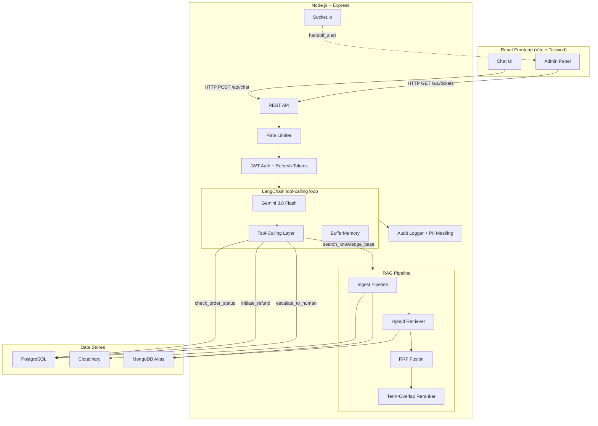

# AI Customer Support Chatbot

A RAG-powered agentic chatbot using MERN stack + LangChain + Gemini API + MongoDB Atlas Vector Search.

## Stack
- **Frontend**: React + Tailwind CSS (Vite)
- **Backend**: Node.js + Express
- **AI**: Gemini 3.8 Flash + LangChain tool-calling (model is configurable)
- **Embeddings**: Gemini Embedding 2
- **Vector DB**: MongoDB Atlas Vector Search (hybrid: vector + keyword/BM25)
- **Relational DB**: PostgreSQL (Neon)
- **File Storage**: Cloudinary
- **Real-time**: Socket.io (WebSockets)

## Architecture



## Setup

### 1. Clone and install
```bash
cd server && npm install
cd ../client && npm install
```

### 2. Configure environment
Fill in all values in `server/.env`:
```
PORT=5000
MONGODB_URI=mongodb+srv://...
PG_URI=postgresql://...
PG_DNS_RESULT_ORDER=ipv4first
PG_AUTO_SELECT_FAMILY=false
DB_CONNECTION_TIMEOUT_MS=15000
DB_CONNECTION_RETRIES=3
JWT_SECRET=<random-256-bit-hex>
GEMINI_API_KEY=<your-key>
GEMINI_MODEL=gemini-3.8-flash
GEMINI_EMBEDDING_MODEL=gemini-embedding-2
CLOUDINARY_CLOUD_NAME=...
CLOUDINARY_API_KEY=...
CLOUDINARY_API_SECRET=...
EMAIL_USER=your_email@gmail.com
EMAIL_PASS=<gmail-app-password>
EMAIL_SERVICE=gmail
PASSWORD_RESET_DELIVERY=email
CLIENT_URL=http://localhost:8080
```

### 3. MongoDB Atlas — create vector index
In Atlas UI → your collection `doc_vectors` → Search Indexes → create:
```json
{
  "fields": [{
    "type": "vector",
    "path": "embedding",
    "numDimensions": 768,
    "similarity": "cosine"
  }]
}
```

### 4. Seed the database
```bash
cd server && node seed.js
```

### 5. Run
```bash
# Terminal 1: backend
cd server && npm run dev

# Terminal 2: frontend
cd client && npm run dev
```

## API Endpoints

| Method | Endpoint | Auth | Description |
|--------|----------|------|-------------|
| POST | `/api/auth/register` | — | Register a new user |
| POST | `/api/auth/login` | — | Login, returns access + refresh tokens |
| POST | `/api/auth/refresh` | — | Exchange refresh token for new access token |
| POST | `/api/auth/logout` | — | Revoke a refresh token |
| POST | `/api/auth/forgot-password` | — | Email a single-use password reset link |
| POST | `/api/auth/reset-password` | — | Reset a password using an unexpired token |
| POST | `/api/chat` | — | Send message, get AI reply (rate-limited) |
| GET | `/api/chat/:sessionId` | — | Fetch chat history |
| POST | `/api/chat/feedback` | — | Submit thumbs up/down rating |
| POST | `/api/ingest` | Admin | Upload + embed document (multipart) |
| GET | `/api/ingest/docs` | Admin | List knowledge base documents |
| DELETE | `/api/ingest/docs/:name` | Admin | Remove document from KB |
| GET | `/api/analytics/summary` | Admin | Comprehensive platform stats |
| GET | `/api/tickets` | Admin | List escalation tickets (paginated) |
| GET | `/api/tickets/:id` | Admin | Get ticket with conversation context |
| PATCH | `/api/tickets/:id` | Admin | Update ticket status/assignment |

## Agent Tools

| Tool | Purpose |
|------|---------|
| `check_order_status` | Queries PostgreSQL for order details, items, tracking |
| `initiate_refund` | Two-step refund (eligibility check → user confirmation → create) |
| `escalate_to_human` | Creates support ticket with conversation context |
| `search_knowledge_base` | Hybrid RAG search (vector + BM25 + RRF + reranking) |

## Testing

```bash
# Unit tests (agent loop and tools with mocked dependencies)
cd server && npm test

# Integration test (full conversation, requires DB)
npm run test:integration

# Prompt injection resistance tests
npm run test:prompt-injection

# RAG evaluation (30 queries, recall + precision)
node eval_rag.js

# RAG evaluation with faithfulness check (calls Gemini)
node eval_rag.js --faithfulness
```

## Known Limitations & Design Tradeoffs

### Architecture
- **In-memory agent sessions**: `BufferMemory` is stored in a `Map` per server process. This means conversation state is lost on server restart and the backend cannot be horizontally scaled across multiple instances without migrating to a persistent memory store (e.g., Redis or MongoDB-backed memory).
- **No streaming responses**: The chat endpoint waits for the full tool-calling response before returning. For long tool chains, this can result in 5-10 second waits. Implementing streaming via Server-Sent Events or WebSocket would improve perceived latency.

### RAG
- **Lightweight reranking**: The term-overlap reranker is a simple heuristic, not a learned cross-encoder model. It boosts chunks containing exact query terms but cannot understand paraphrases or semantic equivalence. A proper cross-encoder (e.g., a sentence-transformers model) would improve relevance ranking but adds latency and infrastructure complexity.
- **Single embedding model**: We use Gemini's embedding model for both ingestion and retrieval. Using a specialized retrieval model (e.g., `text-embedding-3-large`) might improve recall for certain query types.
- **PDF-only ingestion**: The ingest pipeline currently only handles PDFs. Extending to `.txt`, `.docx`, or structured data (JSON, CSV) would require additional parsers.

### Security
- **Rate limiting is in-memory**: The `express-rate-limit` counters reset on server restart. For production, use a Redis-backed store (`rate-limit-redis`).
- **Guardrails are prompt-based**: Prompt injection resistance relies on system prompt instructions, not deterministic classifiers. Sufficiently creative adversarial inputs may bypass these guardrails. A production system should add a separate input classification layer.
- **Refresh tokens in DB**: Each refresh request hits the database. For higher throughput, consider caching valid tokens in Redis with TTL.

### Agent
- **Confirmation step is prompt-engineered**: The refund confirmation loop (call with `confirmed=false`, ask user, call with `confirmed=true`) depends on the LLM following instructions. In rare cases, the LLM might skip confirmation. A deterministic middleware layer that intercepts refund tool calls could make this bulletproof.
- **No conversation length limit**: Very long conversations can exceed the LLM context window. Adding a sliding window or summarization step for long sessions would prevent this.
